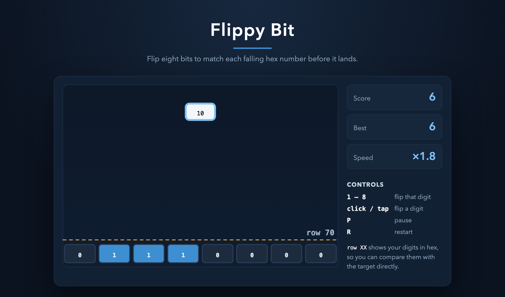
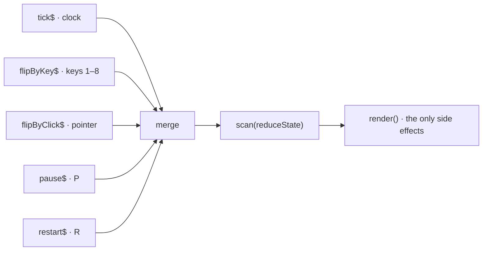

# Flippy Bit

A binary reflex game. Hexadecimal numbers fall toward a line, and you flip eight
bits to match each one before it lands. Built with TypeScript and RxJS, with
every game rule written as a pure function.

**[▶ Play it in your browser](https://rgxeva.github.io/flippy-bit/)**



## How to play

- The **outlined** number is the one being judged. Only the lowest target
  counts; the ones above it wait their turn.
- Press **1–8** or click/tap a digit to flip it. `row XX` beside the line shows
  your row in hex, so you can compare it with the target directly.
- A target clears the moment your row matches it. Let one reach the dashed
  line unmatched and the game ends.
- The fall speeds up the longer you survive, up to a cap that keeps the game
  winnable. **P** pauses, **R** restarts, and your best score is kept in the
  browser.

## Highlights

- **Functional reactive design.** Five event streams (clock, keyboard,
  pointer, pause, restart) each turn their events into an `Action`. One
  `merge` and one `scan` fold them into a single immutable game state, and
  `render` is the only place with side effects.
- **Pure, deterministic game logic.** `state.ts` never touches the DOM or reads
  the clock. A seeded Lehmer generator makes every run reproducible, so the
  tests can drive thousands of time steps directly in Node.
- **Tests that were themselves tested.** 87 Vitest tests, checked with
  mutation testing: 21 deliberate faults were injected one at a time and every
  one was caught (details below).
- **Desktop and mobile.** Pointer events handle mouse and touch alike, and the
  canvas scales to the screen.

## Architecture



```ts
merge(tick$(), flipByKey$(), flipByClick$(), restart$(), pause$()).pipe(
    scan(reduceState, { ...initialState, seed: startingSeed(), best: startingBest() }),
);
```

| Module | Role |
| --- | --- |
| `src/types.ts` | The type model and every tuning constant |
| `src/state.ts` | Pure state transitions: each rule of the game |
| `src/util.ts` | Helpers that know nothing about the game (pipeline, PRNG, hex) |
| `src/observable.ts` | Browser events turned into `Action` streams |
| `src/view.ts` | SVG rendering and storage, the only module with side effects |
| `src/main.ts` | Wiring: streams → fold → renderer |

A time step is a pipeline of small pure functions:

```ts
const step = pipeline(clearExit, advanceClock, fall, despawn, spawn, judge);
```

## Testing

```bash
npm run test:run
```

The tests are grouped the way the game is built: the helpers, each stage of a
time step, the actions, and finally properties that must hold across a whole
run. That last group catches real regressions, because it checks rules no
single function owns:

- no state is ever mutated, and no frame is written into after it is produced;
- every target that leaves the board passes through `exit`, so no SVG element
  is leaked;
- the score and the best score never decrease, the digit row stays eight digits
  long, and the board never grows without bound;
- the same seed replays identically, and different seeds diverge.

**Mutation testing.** To check the tests rather than count them, 21 faults
were introduced one at a time: judging the wrong target, dropping the `exit`
handoff, removing the speed ceiling, reversing the bit order, an off-by-one in
the digit flipped, mutating targets in place, and more. Every one was caught.
The exercise also exposed a blind spot: mutating a target's height in place
survived the first round, because the immutability test only checked the
opening state. Two tests close it, one of which snapshots every frame as it is
produced and re-reads them all at the end.

## Run locally

Requires Node.js 20 or later.

```bash
npm ci
npm run dev        # open the URL printed in the terminal
npm run test:run   # run the test suite once
npm run build      # type-check and build into dist/
```

## Deployment

`.github/workflows/deploy.yml` runs the tests, builds the game and publishes
it to GitHub Pages on every push to `main`. To turn it on, open the
repository's **Settings → Pages** and set **Source** to **GitHub Actions**.

## License

[MIT](LICENSE) © 2026 Yiyou Xu
